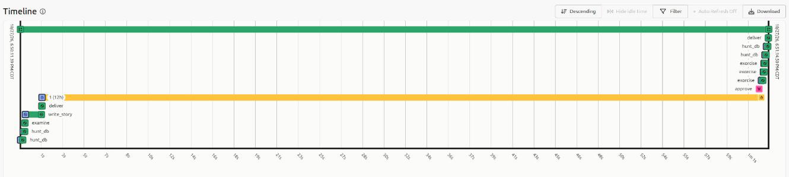
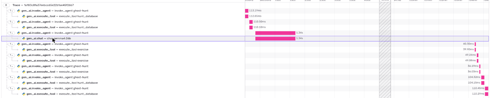
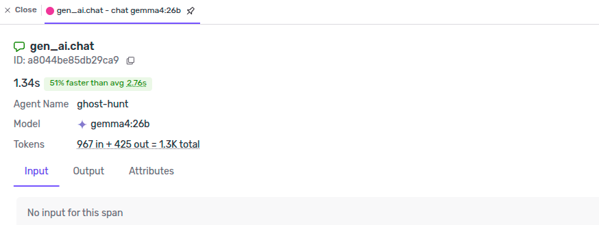

# Ghost Hunt

[](https://github.com/pyaroslav/ghost-hunt/actions/workflows/tests.yml)


**Ghost Hunt finds what's still haunting your Oracle databases, and lays it to rest only when you say so.**

A ghost is something still in the database after whatever owned it is gone: a session whose user went home
with a transaction open, a distributed transaction that crashed halfway and now holds a row nobody can even
read, a control file the database stopped using two weeks ago, a dropped table still holding its space, a
contractor's locked account whose nightly job still runs.

SQL finds every ghost. Gemma, running locally, writes the field notes. A Temporal workflow waits, for hours if
need be, for a person to approve each exorcism, and then hunts again to prove the ghost is gone.

```
### 2. ⛓️ Distributed transaction 10.9.199680 is prepared and nobody is coming back for it
`lab-se2` · `ORCLPDB1`. Since 2026-10-27 22:37.

_Here lies 10.9.199680, a prepared distributed transaction from 22:37 on 2026-10-27. It waits for a master that will never return._

The other side: lab-26ai/FREEPDB1 committed. Decision: commit force: the other side committed.

Exorcism, if you approve it:
    commit force '10.9.199680';
    begin dbms_transaction.purge_lost_db_entry('10.9.199680'); commit; end;
```

## The ghosts

| Ghost | Found with | Exorcised by the hunter? |
|---|---|---|
| 🕯️ Session idle with an open transaction, others waiting on it | `v$session` ⋈ `v$transaction` | Yes: `kill session ... immediate` |
| 🕯️ Session idle with an open transaction, nobody waiting yet | same | No: ask its owner |
| 🕯️ Session killed but still rolling back | `v$session.status = 'KILLED'` | No: it leaves when the rollback ends |
| ⛓️ In-doubt distributed transaction | `dba_2pc_pending` on **both** databases | Yes: forced the way the other side went, then purged |
| 📜 Database file on disk that the database no longer lists | `find` vs `v$datafile`/`v$controlfile`/... | No: you move it aside yourself |
| ⚰️ Dropped table still holding space | `dba_recyclebin` | No: SQL to purge or flash back |
| 🪦 Invalid object | `dba_objects.status` | No: SQL to recompile |
| 🗝️ Locked or expired user whose scheduler jobs still run as it | `dba_users`, `dba_scheduler_jobs` | No: disable, hand over or drop |

The hunter only exorcises the two kinds where the right move can be read off the database: a session that
others are waiting on, and an in-doubt transaction whose partner is visible. For an in-doubt transaction it reads
both databases and only follows an outcome that is already written down somewhere: if the other side committed,
it forces a commit; if the other side was rolled back, a rollback. **Otherwise it refuses to guess** (one side
visible, every visible side still prepared, or a mixed outcome) and tells you what to look up. The committed side's
entry is the only written record of the outcome, so it's purged only after its prepared partner has been forced in
the same run, never on its own. Everything else gets the SQL and a sentence, and a person runs it.

An approval can arrive hours after the hunt, so **every exorcism checks its ghost again first**: the same session
(sid, serial# and transaction id), still idle, still blocking someone; the same transaction, still prepared. If
anything changed, nothing is run and the report says so.

## How it works

1. **Hunt** ([`ghosthunt/hunt.py`](ghosthunt/hunt.py)). One query per kind of ghost, run in each PDB by
   `c##ghost`, which has `CREATE SESSION` and `SELECT ANY DICTIONARY` and nothing else. Client machine names, OS
   users and SQL text are never selected. Files are listed with `find` in the CDB's own data directory, through
   `docker exec` (or locally with `"files": "local"`); if that fails, the report says files weren't checked and
   the rest of the hunt goes on.
2. **Rank and pair** (`examine` in [`ghosthunt/flow.py`](ghosthunt/flow.py)). In-doubt transactions are matched
   across databases by global transaction id, and the decision is made in code. Ghosts are numbered by harm:
   whatever is blocking someone right now comes first.
3. **Narrate** ([`ghosthunt/narrate.py`](ghosthunt/narrate.py)). Gemma 4 (26B, on Ollama) gets the ghosts'
   names, facts and dates. It writes two summary lines and one epitaph per ghost. Each line is checked: it must
   name its ghost, and every number and identifier (anything with an underscore or a dot, like `GH_AUDIT_2019`)
   must appear in that ghost's entry. A failed line gets one
   retry, then a plain line from the facts replaces it. If the model can't be reached at all, every line comes from
   the template and the report still goes out. The list of ghosts, their order, the decisions and the SQL never
   come from the model.
4. **Wait** (Temporal). The report is written and a desktop notification goes out. Then the workflow waits for
   an `approve` signal, 12 hours by default. If nobody answers, nothing is touched. The worker can die and come
   back while it waits, and an approval by number can arrive while it's down (`all` needs a worker to list the
   ghosts).
5. **Exorcise and check** ([`ghosthunt/exorcise.py`](ghosthunt/exorcise.py)). Only the approved ghosts, each
   checked again first, as `c##exorcist`: `CREATE SESSION`, `SELECT ANY DICTIONARY` (for the checks),
   `ALTER SYSTEM` (to kill a session), `FORCE ANY TRANSACTION`, `EXECUTE` on `DBMS_TRANSACTION`, and `DELETE` on
   the three pending-transaction tables `purge_lost_db_entry` cleans. `ALTER SYSTEM` is a broad privilege; that's
   why the exorcist is a separate account from the hunter. Then the databases are hunted again, and the final
   report says which ghosts are gone, which are still there, and which it couldn't check.
6. **Trace** ([`ghosthunt/trace.py`](ghosthunt/trace.py)). With `SENTRY_DSN` set, each activity is a Sentry
   `gen_ai.invoke_agent` transaction in one trace per hunt, with `execute_tool` and `chat` spans. **Only metadata
   leaves the machine:** model name, token counts, timings, how many ghosts of each kind. No SQL, no object or
   user names, no prompts, no answers. Error messages are cut down to their ORA- code. Sentry's servers see the
   IP address an event comes from and would turn it into a city, so Ghost Hunt sends `0.0.0.0` as the user's
   address; also turn on the project's "Prevent Storing of IP Addresses" setting. Stack frames lose
   their file paths. Sentry's standard-library instrumentation is off, because a `subprocess` span carries its
   command line. I found that the first time I
   looked at a trace. [`tests/test_core.py`](tests/test_core.py) checks the scrubbing.



The demo run's full event history is in [`results/demo-history.json`](results/demo-history.json) (`temporal workflow show --output json`). The hunt ran on worker `3143315`; the exorcisms and the second hunt ran on `3144782`, started after the first was killed with `kill -9`.





## Which Gemma?

The checks catch a line that names the wrong ghost or invents a number. They can't catch a sentence that uses
the right names and still says something untrue. So I ran the narrator 20 times on the same hunt with each
model and read every line ([`results/claims.md`](results/claims.md), raw lines in `results/eval.json`):

| 7 ghosts, 20 runs | gemma4:e4b | gemma4:26b |
|---|---|---|
| Epitaphs and summaries passing the automatic checks | 160 / 160 | 160 / 160 |
| Epitaphs with a false claim (read by hand) | **24 / 140** | **1 / 140** |
| Summaries (two lines each) with a false claim | 5 / 20 | 0 / 20 |
| Median seconds per report, one call (model loaded) | 1.05 | 1.32 |

e4b's mistakes all sounded right: a dropped table holding "7.0 MB of memory", the blocking session "still
waiting for another session", a committed transaction "already purged" before anyone had approved anything. So
the default is the 26B model.

## Run it

You need Python 3.10+, [Ollama](https://ollama.com) with `gemma4:26b` (or set `GHOST_MODEL`), and an Oracle CDB
(12.2 or later) you're allowed to haunt.

```bash
pip install -e .
ollama pull gemma4:26b
# accounts: c##ghost (reads) and c##exorcist (kills sessions, forces transactions)
export GHOST_HUNTER_PASSWORD=... GHOST_EXORCIST_PASSWORD=...
lab/users.sh <container> <ORACLE_SID>
cp targets.json my-targets.json           # host:port, CDB service, PDBs; "container" or "files": "local" for the file check

ghost-hunt now --targets my-targets.json   # report only; touches nothing; no Temporal needed
ghost-hunt server                          # local Temporal: one binary, a SQLite file, UI on :8234
ghost-hunt worker                          # leave it running
ghost-hunt hunt --targets my-targets.json  # report, then waits for approval
ghost-hunt approve <hunt-id> 1 2 3         # or: all
ghost-hunt status <hunt-id>
```

Passwords and `SENTRY_DSN` are read from `~/.ghost-hunt.env`, never from the repo. `GHOST_IDLE_MINUTES` (default
10) sets how long a session must sit idle with an open transaction before it counts.

## The lab

[`lab/plant.py`](lab/plant.py) plants one of each ghost in two Docker databases, Oracle 26ai Free and 12.2 SE2,
so a hunt has something to find:

- the in-doubt transaction is a transfer across a database link, crashed after prepare with Oracle's own test
  hook, `COMMIT COMMENT 'ORA-2PC-CRASH-TEST-7'`;
- distributed recovery is disabled on both, or RECO would quietly resolve it within seconds;
- the link goes from 12.2 to 26ai because the other direction fails with ORA-28267;
- the lingering session and its victim are two Python clients left running. A freshly planted session has only
  been idle for seconds, so hunt the lab with `GHOST_IDLE_MINUTES=1` (or 0).

`plant.py`, `lab/peek.py` and the two clients connect as a `LAB` user in each PDB, with its password in
`GHOST_LAB_PASSWORD`; the container names and ports of my two labs are at the top of `plant.py`.

One ghost wasn't planted: `control02.ctl` on the 12.2 lab. On Oct 13 at 16:07, while the container was creating
the database, its setup script set `control_files` to `control01.ctl` alone. `control02.ctl` was last written a
minute later and has sat there since. Nobody noticed, including me, until Ghost Hunt's first run.

## Tests

`pytest` runs in CI without a database:

- the in-doubt decisions (commit, rollback, refuse to guess, never purge the written outcome alone);
- only a session someone waits on can be killed, and the kill re-checks the same session and transaction;
- the ranking;
- the line checks;
- the Sentry scrubbing;
- the workflow on Temporal's time-skipping test server: only approved ghosts are touched; a ghost that changed
  since the hunt is left alone; a purge waits for its partner's force; a check that can't run isn't reported as
  success; the report goes out without the model; a database that can't be reached becomes a line in the
  report; and twelve hours with no answer touch nothing.

## Why local and open

Everything Ghost Hunt reads (session lists, transaction ids, file paths, user names) is exactly what a DBA
can't paste into a hosted chatbot. Gemma runs on the same machine as the databases, Temporal is one binary with a
SQLite file, and the only thing that can leave is the metadata in Sentry, which is optional and listed above.
It costs nothing per hunt. Because the model is open and local, I could ask two sizes of it 40 times on the same input,
read all 280 epitaphs, and pick the model on what it actually said.

## Credits

The checked-model-output-with-a-template-fallback idea and the local Temporal setup come from my earlier
project [Night Shift](https://github.com/pyaroslav/night-shift). Everything here was written for this challenge,
Oct 27 to 31, 2026.

## License

MIT
